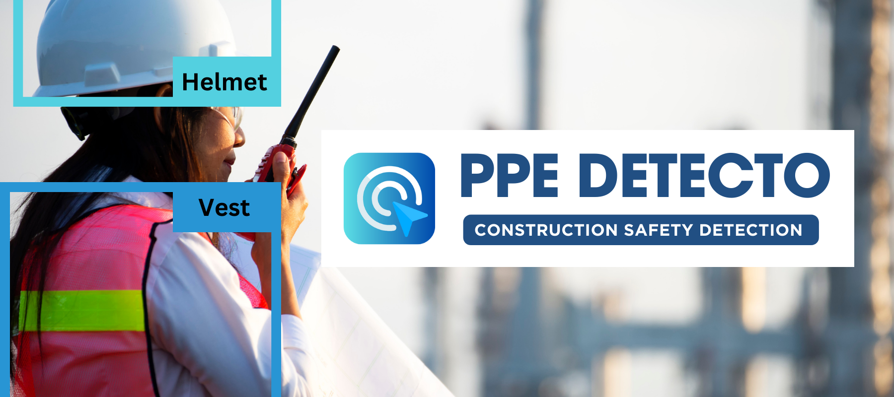

# Nexora — Real-Time Multi-Sector PPE Compliance Platform

**Nexora** is a full-stack, real-time Personal Protective Equipment (PPE) compliance monitoring platform built for **Construction Sites / Industrial Facilities** and **Medical / Healthcare Environments**.

Nexora runs as a self-contained on-premise installation, connects to existing cameras (**RTSP / IP cameras, Webcams, or Video Files**), runs real-time AI detection using dedicated **Ultralytics YOLO** models per sector, and serves an Arabic RTL React dashboard with annotated video and WebSocket telemetry. Alerts are stored locally by default; optional SMTP/HTTP integrations are customer-configured and not required for operation.



---

## Key Features

- **Smart Hybrid AI Engine (`construction` + `medical` fused):**
  - **Construction Model (`Model/ppe.pt`):** Detects `Person`, `Hardhat` / `NO-Hardhat`, `Safety Vest` / `NO-Safety Vest`, `Mask` / `NO-Mask`, `Gloves` / `NO-Gloves`, `Safety Boots` / `NO-Safety Boots`, and `Goggles` / `NO-Goggles` with person-bounding-box IoU association.
  - **Medical Model (`Model/bestMedicalModel.pt`):** Detects `mask` / `no mask`, `hand gloves` / `no hand gloves`, `head cap` / `no head cap`, `goggle` / `no goggle`, `lab coat`, `full cover`, and `shoe cover` with grace-period debouncing.
  - **`HybridPPEDetector` (`app/core/hybrid_detector.py`):** Runs **both** YOLO models on the same frame, normalises every class name to one canonical vocabulary (`no goggle` ≡ `NO-Goggles`), merges duplicate boxes with **cross-model confidence fusion**, resolves positive/negative conflicts, and feeds a single detection list to the existing checkers. Medical cameras finally get a `Person` class (the medical model has none), so PPE items can be associated with staff and "staff present but lab coat missing" works out of the box.
  - **Construction → Medical Bridge (`_bridge_construction_to_medical`):** When a medical camera borrows the construction model, only what the medical profile can use crosses over — `Person` plus the shared items (Mask / Goggles / Gloves). Construction-only classes (Hardhat, Safety Vest, Safety Boots) are dropped before they can pollute medical counters, and the crossing count is published as `bridged` in the hybrid stats. A final **medical firewall** in `detect()` drops construction-only classes from *any* source, and `MedicalViolationChecker` ignores them defensively — a medical camera can never report a missing hardhat/vest/boots.
  - **Anatomical Eye Bridge (`_append_anatomical_eye_bridge`):** On medical cameras running *without* any `Person` box (e.g. `HYBRID_CONSTRUCTION_ON_MEDICAL=false`), every `Mask` detection is used as an anatomical anchor — the eye line sits directly above the mask, so the nose-bridge test still runs and can emit `NO-Goggles` (`skin:anatomical_bridge`).
  - **Glove reject ratio (`SKIN_GLOVE_REJECT_RATIO`, default `0.24`):** A `Gloves` box whose region contains **≥ 24 %** thick exposed skin (distanceTransform) is a fake glove and is downgraded to `NO-Gloves` — stricter than the generic `SKIN_STRONG_RATIO` because a real glove never shows skin in its middle.
  - **Precision guards (`SKIN_*` guard settings):** Skin heuristics are evidence helpers, not models — so their output is confidence-capped (`SKIN_SYNTHETIC_MAX_CONF`, default `0.85`), a skin-sourced negative only counts as *violation evidence* at `≥ SKIN_NEGATIVE_MIN_CONF` (`0.70`), the anatomical scans only anchor on a reliable `Person` (`SKIN_MIN_PERSON_CONF`, `0.35`), and dropping a model positive (Mask/Goggles/Gloves) now needs a strong heuristic (`SKIN_POSITIVE_OVERRIDE_MIN_CONF`, `0.70`) and only works on positives below `SKIN_POSITIVE_OVERRIDE_MAX_CONF` (`0.60`). A model detection confirmed by skin (`model:x+skin:y`) keeps its full evidence weight. On top of that, `DETECTION_CONFIDENCE_FLOOR` (`0.25`) automatically raises any configured inference/class threshold below it (with a log warning), so stale low settings like `0.05`/`0.10` can't flood the system with false detections.
  - **Safe Weight Migration (`RETIRED_MODEL_PATHS`):** Legacy weights (e.g. the removed `Model/bestMedicalModel2.pt`) can never be loaded again: any `.env` still pointing at them is redirected to the approved replacement automatically, retired paths are skipped in fallback lists, and `sanitize_class_conf_thresholds` drops per-class confidence thresholds whose class ids do not exist in the loaded model.
- **Smart Skin Layer (`app/core/skin_analysis.py`):** Adds deterministic OpenCV evidence on top of the models:
  - **`calc_skin_ratio`** — dual-threshold (HSV + YCrCb) skin pixel ratio per region.
  - **Bare-hand detection with `distanceTransform`** — a real bare hand is a *thick* skin blob; gloved hands and stray skin (wrists/arms/background) are not. Confirms `NO-Gloves`, downgrades fake `Gloves`, and scans for bare hands when the models report no glove box at all.
  - **Eye-bridge `NO-Goggles`** — if the strip between the eye centres (the nose bridge) is skin/eye coloured, goggles are not worn → emits `NO-Goggles`. If instead a glass/opaque band covers the eye line, `Goggles` is confirmed. Works with `haarcascade_eye` when available and with the built-in contrast eye detector on OpenCV 5 (where `cv2.CascadeClassifier` was removed).
  - Every produced/fused detection is tagged (`model:medical+skin:eye_bridge`, …) and drawn with a `[skin]` marker in the live stream, and `skin_hits` is published in the WebSocket counts.
- **Per-Camera Custom Monitoring Rules:** Configure which PPE items are required on each camera independently and update rules on the fly without restarting the stream.
  - **Rule-Synced Display (`_filter_detections_for_display`):** The annotated stream draws exactly what the camera actually checks — `Person` (for context) plus the enabled classes only, including skin-generated detections. Disabled classes never appear on the video or the on-screen stat lines, even if a model detects them (WebSocket telemetry still carries the full picture).
- **Role/Sector Access Control:** `admin`, `operator`, and `viewer` roles with construction/medical sector isolation on cameras, streams, frames, violations, user administration, and metrics. Viewers are read-only; admin promotion is reserved for the local CLI.
- **On-Prem Security:** Secure-by-default network camera/video allowlists, explicit production secrets and HTTPS-only startup, exact CORS/host allowlists, HttpOnly/Secure/SameSite cookies, short-lived media sessions, login throttling/account lockout, first-login password rotation, audit events, and AES-256-GCM encrypted PostgreSQL backups.
- **Live Streaming & Telemetry:**
  - Authenticated **MJPEG** video streaming (`/api/v1/stream/{camera_id}`) with frame-sequence deduplication.
  - Real-time **WebSocket** live detection counters (`/api/v1/ws/{camera_id}`).
- **Multi-Channel Alert Dispatcher:** Local Database (`violations` + `alert_log`) delivery is built in; optional SMTP and HTTP/webhook integrations can target customer-approved services and are not needed for on-prem operation.
- **Modern RTL Arabic Dashboard:** Built with **React 19, TypeScript, Tailwind CSS v4, Radix UI, TanStack Query, and Recharts**, featuring dark/light themes, live compliance rings, time-series analytics, camera management, and CSV export.

---

## Project Structure

```text
Nexora---PPE/
├── app/
│   ├── alerts/            # AlertHandler ABC, AlertDispatcher, Email, Slack & Webhook handlers
│   ├── api/routes/        # FastAPI routers: auth, cameras, violations, stream, meta, health
│   ├── camera/            # CameraManager & sources (RTSP, Webcam, Video File)
│   ├── core/              # Settings, JWT Auth, PPEDetector, HybridPPEDetector, SkinAnalysis, Checkers
│   ├── db/                # SQLAlchemy 2.0 Async models, session, and repository helpers
│   ├── schemas/           # Pydantic v2 request/response schemas
│   └── main.py            # FastAPI application factory, lifespan, and SPA static serving
├── frontend/              # React 19 + TypeScript + Vite + Tailwind CSS v4 dashboard
├── migrations/            # Alembic database migrations (SQLite, PostgreSQL, SQL Server)
├── Model/                 # Bundled YOLO weights (ppe.pt, bestMedicalModel.pt)
│                          #   bestMedicalModel2.pt was RETIRED — stale .env entries are
│                          #   auto-migrated to bestMedicalModel.pt (safe weight migration)
├── docker/                # Multi-stage production Dockerfile & development Dockerfile.dev
├── tests/                 # Unit and integration test suites (pytest + httpx AsyncClient)
├── docker-compose.yml     # Production stack (FastAPI + React SPA + PostgreSQL 16)
└── docker-compose.dev.yml # Development stack with hot-reload (FastAPI + Vite dev server)
```

---

## Quick Start

### 1. Local Development (`dev`)

#### Backend (FastAPI)

```bash
# 1. Create and activate a virtual environment
python -m venv .venv
source .venv/bin/activate        # Linux / macOS
# .venv\Scripts\activate         # Windows

# 2. Install dependencies
pip install -r requirements.txt

# 3. Copy environment configuration
cp .env.example .env

# 4. Set a local camera/video allowlist in .env when you use those sources.
#    Keep ALLOWED_RTSP_PREFIXES empty to disable all network camera sources.

# 5. Start the API server with hot-reload (versioned migrations run before serving)
uvicorn app.main:app --reload --host 0.0.0.0 --port 8000
```

- **API Docs (Swagger UI):** `http://localhost:8000/docs`
- **Health Check:** `http://localhost:8000/api/v1/health`

#### Frontend (React + Vite)

```bash
cd frontend
npm install
npm run dev
```

- Open `http://localhost:5173` (Vite proxies `/api` and `/frames` to the API, including WebSockets).
- There are no default credentials. In development only, when no bootstrap password is configured, the server generates a random one and prints it once at startup. The account must change it at first sign-in.

---

### 2. Production Deployment (`prod`)

#### Option A: Docker Compose (Recommended)

The production stack builds the React SPA, FastAPI API, PostgreSQL, and a Caddy HTTPS reverse proxy (Docker Compose plugin v2.33+). App and DB ports are not published to the LAN; only the HTTPS proxy is exposed. Each customer site should have a separate installation/database.

```bash
python scripts/setup_onprem.py \
  --host nexora.customer.lan \
  --rtsp-prefix rtsp://192.168.10. \
  --rtsp-prefix rtsp://10.10.0.
# Review the generated .env and replace the sample camera ranges with the real camera VLANs.
docker compose up --build -d
```

Browse to `https://nexora.customer.lan`. Caddy uses an internal CA by default; export its **public root certificate only** with `docker compose cp proxy:/data/caddy/pki/authorities/local/root.crt certs/nexora-root.crt` and distribute it to approved devices, or install an organization-trusted certificate. Check that the default Docker subnets `172.30.100.0/24` and `172.30.101.0/24` do not overlap customer/VPN routes; select alternatives with `--edge-subnet` and `--data-subnet` during setup if needed. The API container also joins a camera-facing bridge so it can reach site cameras; filter host/container egress to approved camera networks and deny public egress. The isolated Caddy/API and API/DB networks restrict paths and trust to the pinned Caddy address. Restrict published ports 80/443 with the customer firewall/VPN; do not publish port `8000` or PostgreSQL.

There are no default production secrets or user accounts. The setup command generates a unique JWT key, bootstrap password, PostgreSQL password, and backup encryption key. The `admin` password is shown once and must be changed at first login. After payment is confirmed manually, issue an account locally:

```bash
docker compose exec app python -m app.cli create-user \
  --username customer1 --sector construction --role viewer
```

The CLI displays a temporary password once. Deliver it privately. There is no cloud payment check or self-signup; if the seller must retain control of issuance, do not give the customer the `admin` account. See [On-Prem Security & Operations](docs/ON_PREM_SECURITY_AR.md) for account lifecycle, camera allowlists, TLS trust, encrypted backup/restore, and limitations.

For development with Docker, use the independent `docker-compose.dev.yml` stack:

```bash
docker compose -f docker-compose.dev.yml up --build
```

#### Bare-Metal Production

Bare-metal deployments must meet the same requirements as Compose: explicit random secrets, `APP_ENV=prod`, exact HTTPS CORS/host allowlists, RTSP and video-path allowlists, PostgreSQL migrations, a trusted HTTPS reverse proxy, one API worker, firewall rules, and encrypted backups. See [On-Prem Security & Operations](docs/ON_PREM_SECURITY_AR.md); do not launch production on an exposed plain-HTTP Uvicorn port.

---

## Environment Variables Reference (`.env`)

| Variable | Default | Description |
| :--- | :--- | :--- |
| `APP_ENV` | `dev` | Environment mode (`dev`, `staging`, `prod`) |
| `DATABASE_URL` | `sqlite+aiosqlite:///./ppe_detection.db` | Async SQLAlchemy connection URL (`sqlite+aiosqlite`, `postgresql+asyncpg`, `mssql+aioodbc`) |
| `JWT_SECRET` | Random development-only key | Production requires an explicitly configured high-entropy secret (generated by `scripts/setup_onprem.py`) |
| `ACCESS_TOKEN_EXPIRE_MINUTES` | `240` | Production allows 60–480 minutes; user must sign in again at expiry |
| `MEDIA_TOKEN_EXPIRE_MINUTES` | `10` | Short-lived media-only token cookie; production allows 5–15 minutes |
| `BOOTSTRAP_USERNAME` | `admin` | Initial local administrator created only when the user table is empty |
| `BOOTSTRAP_PASSWORD` | Random development-only password | Production requires a strong explicit password; force-changed on first sign-in |
| `BOOTSTRAP_SECTOR` | `both` | Initial admin sector (`construction`, `medical`, `both`) |
| `CORS_ORIGINS` / `ALLOWED_HOSTS` | Local Vite origins / `*` in dev | Exact customer HTTPS origin and hostname; wildcard is rejected in production |
| `ALLOWED_RTSP_PREFIXES` | Empty (network camera sources denied) | Comma-separated site camera ranges/origins; required in production |
| `ALLOWED_VIDEO_DIR` | Empty (file sources denied) | Dedicated directory inside the app/container; required in production |
| `LOGIN_RATE_LIMIT` / `LOGIN_RATE_WINDOW_SECONDS` | `5` / `60` | Login attempts per client IP and rolling window |
| `LOGIN_LOCKOUT_ATTEMPTS` / `LOGIN_LOCKOUT_MINUTES` | `5` / `15` | Persistent temporary user lock after repeated failures |
| `BACKUP_ENCRYPTION_KEY` | Empty | Explicit URL-safe 256-bit key required in production for AES-GCM database backups |
| `CONSTRUCTION_MODEL_PATH` | `Model/ppe.pt` | Path to YOLO weights for construction cameras |
| `MEDICAL_MODEL_PATH` | `Model/bestMedicalModel.pt` | Path to YOLO weights for medical cameras |
| `HYBRID_DETECTION_ENABLED` | `true` | Fuse the construction + medical models in one `HybridPPEDetector` per camera profile |
| `HYBRID_CONSTRUCTION_ON_MEDICAL` | `true` | Run the construction model alongside medical cameras (adds `Person` + association) |
| `HYBRID_MEDICAL_ON_CONSTRUCTION` | `false` | Run the medical model alongside construction cameras (mask/goggle verification, heavier) |
| `HYBRID_MERGE_IOU` / `HYBRID_CONFLICT_IOU` | `0.55` / `0.30` | Duplicate-merge and positive/negative conflict thresholds |
| `HYBRID_OVERRIDE_MIN_CONTAINMENT` | `0.45` | Minimum smaller-box coverage before the skin layer may override a model box |
| `HYBRID_HEAD_REGION_RATIO` | `0.32` | Top fraction of a person box treated as the head/face region |
| `SKIN_FILTER_ENABLED` | `true` | Master switch for the skin layer (`calc_skin_ratio`) |
| `SKIN_BARE_HAND_ENABLED` | `true` | Bare-hand detection via `distanceTransform` |
| `SKIN_EYE_BRIDGE_ENABLED` | `true` | Eye-bridge `NO-Goggles` test |
| `SKIN_MIN_RATIO` / `SKIN_STRONG_RATIO` | `0.18` / `0.32` | Skin ratio that counts as "exposed" / "strong enough to override a positive class" |
| `SKIN_GLOVE_REJECT_RATIO` | `0.24` | Skin ratio inside a `Gloves` box that rejects it as a fake glove (→ `NO-Gloves`) |
| `SKIN_BARE_HAND_MIN_THICKNESS` / `SKIN_BARE_HAND_MIN_AREA` | `0.12` / `0.10` | Minimum distanceTransform thickness and blob area for a bare hand |
| `SKIN_EYE_BRIDGE_MIN_SKIN_RATIO` | `0.22` | Minimum skin ratio in the nose-bridge strip for `NO-Goggles` |
| `SKIN_GLASS_CONFIRM_MIN_RATIO` | `0.05` | Glass-band height ratio that confirms `Goggles` |
| `SKIN_SYNTHETIC_MIN_CONF` | `0.45` | Floor confidence for skin-generated detections |
| `SKIN_SYNTHETIC_MAX_CONF` | `0.85` | Ceiling confidence for skin-generated detections (heuristics don't get model-grade confidence) |
| `SKIN_NEGATIVE_MIN_CONF` | `0.70` | Minimum confidence for a skin-sourced negative to count as violation evidence (below it: displayed only) |
| `SKIN_MIN_PERSON_CONF` | `0.35` | Mouth/eye-bridge/bare-hand scans only anchor on a `Person` at least this confident |
| `SKIN_POSITIVE_OVERRIDE_MAX_CONF` / `SKIN_POSITIVE_OVERRIDE_MIN_CONF` | `0.60` / `0.70` | A model positive may only be dropped below the max, and only by a heuristic at least as confident as the min |
| `DETECTION_CONFIDENCE_FLOOR` | `0.25` | Any configured inference/class confidence below this is raised automatically (log warning) |
| `DB_SQL_ECHO` | `false` | Echo every SQL statement to the log (previously always on in `dev`, printing each query twice) |
| `ALERT_COOLDOWN_SECONDS` | `60` | Minimum seconds between repeated alerts for the same PPE type per camera |
| `VIOLATION_PERSIST_SECONDS` | `8` | Seconds a construction PPE violation must persist before triggering an alert |
| `MEDICAL_VIOLATION_PERSIST_SECONDS` | `3` | Seconds a medical PPE violation must persist before triggering an alert |
| `ALLOWED_RTSP_PREFIXES` | *(empty; denies RTSP)* | Comma-separated site camera prefixes; matching includes scheme and hostname, not raw string prefix |
| `ALLOWED_VIDEO_DIR` | *(empty; denies files)* | Required isolated directory; file sources and symlinks are resolved/confined inside it |
| `TRUSTED_PROXIES` | Empty | Only these proxy IP/CIDRs may supply trusted `X-Forwarded-For` values |
| `SENDER_EMAIL` / `RECEIVER_EMAIL` / `EMAIL_PASSWORD` | *(empty)* | SMTP credentials for email alerts |
| `SLACK_WEBHOOK_URL` / `WEBHOOK_URL` | *(empty)* | Optional Slack or generic HTTP webhook URLs |

---

## Hybrid Detection & Skin Filter (Deep Dive)

```text
frame ─┬─► construction YOLO (ppe.pt)          ─┐
       └─► medical YOLO (bestMedicalModel.pt)  ─┤
                                                ▼
                     canonicalise names + construction→medical bridge (medical cams)
                                                ▼
                            merge (IoU) + confidence fusion
                                                ▼
                       resolve positive/negative conflicts (Mask vs NO-Mask …)
                                                ▼
   smart skin layer:  calc_skin_ratio  |  distanceTransform (bare hand)  |  eye bridge (NO-Goggles)
                      + anatomical eye bridge (mask anchor, no Person needed)
                                                ▼
                       list[Detection] ──► ViolationCheckers ──► DB / Email / Slack / Webhook
                                       └──► rule-synced display (enabled classes only on stream)
```

**Why it matters**

| Problem with a single model | Hybrid + skin answer |
| :--- | :--- |
| Medical model has **no `Person`** class | Construction model supplies `Person`; PPE items are associated to the nearest person by IoU |
| `no goggle` vs `NO-Goggles` naming clash | One canonical vocabulary (`app/core/ppe.py::canonical_class_name`) used by merging, checkers and counters |
| Small PPE items missed at low confidence | Second model + skin evidence (`NO-Mask`, `NO-Gloves`, `NO-Goggles`) generated *after* the confidence filter |
| "Gloves" predicted on a bare hand | `distanceTransform` thickness test + **24 % glove reject ratio** downgrade fake `Gloves` to `NO-Gloves` |
| False `NO-Goggles` on someone wearing goggles | The glass-band check on the eye line confirms `Goggles` instead |
| No `NO-Goggles` when the medical camera runs without `Person` | The **anatomical eye bridge** anchors the nose-bridge test on each detected `Mask` |
| Construction-only boxes (helmet/vest/boots) on medical streams | The **construction→medical bridge** only passes `Person` + shared items across, a final firewall in `detect()` drops them from any source, and the medical checker ignores them defensively |
| Old weights re-loaded by a stale `.env` | **Safe weight migration**: retired paths redirect to the approved replacement and stale class-id thresholds are dropped |
| Stream shows boxes the camera does not check | **Rule-synced display** draws only enabled classes (+ `Person`) on the annotated video |
| Repeated `no mask` / `no hand gloves` violations from weak skin boxes | **Precision guards**: skin negatives below `SKIN_NEGATIVE_MIN_CONF` are display-only, synthetic confidence is capped at `SKIN_SYNTHETIC_MAX_CONF`, and scans anchor only on reliable `Person` boxes |
| Old thresholds like `0.05`/`0.10` produce junk detections | **`DETECTION_CONFIDENCE_FLOOR`** raises them automatically at load time (with a warning) |
| SQL statements flood the log (twice per query) in `dev` | **`DB_SQL_ECHO`** is now off by default — enable it only while debugging queries |
| `SAWarning: Unrecognized server version info '17.0.…'` on SQL Server 2025 | Fixed by requiring **SQLAlchemy ≥ 2.0.50** |

**Tuning tips**

* Too many `NO-Goggles` alerts → raise `SKIN_EYE_BRIDGE_MIN_SKIN_RATIO` (e.g. `0.30`) or set `SKIN_EYE_BRIDGE_ENABLED=false`.
* Bare-hand scan too eager → raise `SKIN_BARE_HAND_MIN_THICKNESS` / `SKIN_STRONG_RATIO`.
* Too many recorded violations from skin evidence → raise `SKIN_NEGATIVE_MIN_CONF` (e.g. `0.80`).
* Still too many false detections at all → raise `DETECTION_CONFIDENCE_FLOOR` (e.g. `0.30`).
* CPU-only hosts → keep `HYBRID_MEDICAL_ON_CONSTRUCTION=false` (default) so construction cameras still run one model.
* Need the old behaviour? `HYBRID_DETECTION_ENABLED=false` restores one-model-per-profile exactly as before.

**Verification**

```bash
# unit tests for the skin layer + hybrid detector (no GPU / torch weights needed)
pytest tests/unit/test_skin_analysis.py tests/unit/test_hybrid_detector.py \
       tests/unit/test_hybrid_bridge.py tests/unit/test_hybrid_anatomical.py \
       tests/unit/test_glove_reject.py tests/unit/test_weight_migration.py \
       tests/unit/test_display_filter.py tests/unit/test_precision_guards.py -v
```

---

## ملخص التحديث بالعربية (Detection Update)

### تحديث الدقة والحراس (2026-10-12 — Precision & Medical Firewall)

- **كاميرا طبي عمرها ما تقول "ناقص خوذة":** الفئات الإنشائية الخالصة (خوذة/فيست/حذاء أمان) مسدودة
  الآن على ثلاث طبقات — الجسر الإنشائي بيمنعها من الموديل، وفايروول نهائي في `detect()` بيمنعها من
  أي مصدر تاني، والـ checker الطبي بيتجاهلها دفاعيًا. مفيش مسار ممكن يطلّع مخالفة خوذة على كاميرا طبية.
- **حارس الدقة (`DETECTION_CONFIDENCE_FLOOR=0.25`):** أي عتبة إنتاج كشف أقل من الأرضية (زي
  `0.05`/`0.10` اللي كانت في الإعدادات) بتترفع تلقائيًا مع تحذير في اللوج — كانت بتنتج `Person`
  بيتقلب بين 0.26 و 0.93 وكشوف وهمية على كل فريم.
- **سقف ثقة الهوريستيك (`SKIN_SYNTHETIC_MAX_CONF=0.85`):** فلتر الجلد مش موديل مُدرَّب — مينفعش
  يطلع `NO-Mask` بثقة 0.96 زي اللوج.
- **دليل الجلد الضعيف مش بيسجّل مخالفات (`SKIN_NEGATIVE_MIN_CONF=0.70`):** الكشوف السالبة مصدرها
  الجلد تحت الثقة دي بتتعرض على البث بس؛ كشف موديل (`model:*`) أو موديل مؤكَّد بالجلد (`model:x+skin:y`)
  بيفضل دليل كامل بأي ثقة.
- **الفحوصات التشريحية على أشخاص موثوقين بس (`SKIN_MIN_PERSON_CONF=0.35`):** فحص الفم/جسر العينين/
  اليدين مبتشتغلش على `Person` ضعيف — ده اللي كان بيولّد `NO-Mask`/`NO-Gloves` وهمي كل فريم.
- **إسقاط الموجبات بقى صارم:** الكمامة/النظارة/القفاز المكتشفة بالموديل فوق `0.60` مش بتتاب إلا
  بهوريستيك واثق `≥ 0.70` (كان 0.55 بيبطل كشف `Mask` لغاية 0.75).
- **تنضيف اللوج:** طباعة استعلامات SQL بقت مقفولة افتراضيًا (`DB_SQL_ECHO=false`) — كانت بتتطبع
  مرتين لكل استعلام — وترقية SQLAlchemy لـ `≥ 2.0.50` شالت تحذير SQL Server 2025
  (`Unrecognized server version info '17.0.1000.7'`).

### تحديث الكشف الهجين (Hybrid Detection)

- **ترحيل آمن للأوزان:** الوزن القديم `Model/bestMedicalModel2.pt` اتشال نهائيًا، وأي إعداد قديم
  في `.env` يشير إليه بيتحوّل تلقائيًا إلى `Model/bestMedicalModel.pt`. كمان عتبات الثقة لكل فئة
  (`*_CLASS_CONF_THRESHOLDS`) بتتنضّف من أي رقم فئة مش موجود في الموديل المحمّل، فمفيش عتبة قديمة
  هتتلزق على فئة تانية بالغلط.
- **الجسر الإنشائي (construction → medical):** كاميرات القطاع الطبي اللي بتستعين بالموديل الإنشائي
  بياخدوا منه `Person` والقطع المشتركة بس (كمامة/نظارة/جوانتي) — الخوذة والفيست والبوت فئات إنشائية
  خالصة وبتسقط قبل العدادات والعرض.
- **الجسر التشريحي (anatomical eye bridge):** لو مفيش `Person` في الكادر (كاميرا طبية والمساعد
  الإنشائي مقفول)، كل كشف كمامة بيستخدم كمرجع تشريحي — خط العينين فوق الكمامة مباشرة، ولو جسر
  الأنف مكشوف بيتسجّل `NO-Goggles`.
- **نسبة رفض القفاز 24%:** أي بوكس `Gloves` جواه ≥24% جلد مكشوف سميك بيتقلب `NO-Gloves`
  (الإعداد: `SKIN_GLOVE_REJECT_RATIO`).
- **مزامنة العرض مع القواعد:** بث الكاميرا بيرسم بس الفئات المفعّلة على الكاميرا (ومعاها `Person`
  للسياق) — أي فئة مش مفعّلة متظهرش على الفيديو ولا في الأسطر الإحصائية.

---

## Testing & Code Quality

```bash
# Backend lint and unit/integration coverage
ruff check app tests migrations scripts train.py
pytest --cov=app --cov-report=term-missing

# Dependency audits (run from an isolated maintenance environment)
pip-audit -r requirements/prod.txt
cd frontend
npm ci
npm audit

# Frontend lint and production build
npm run lint
npm run build
```

---

## License

Released under the [MIT License](LICENSE).
