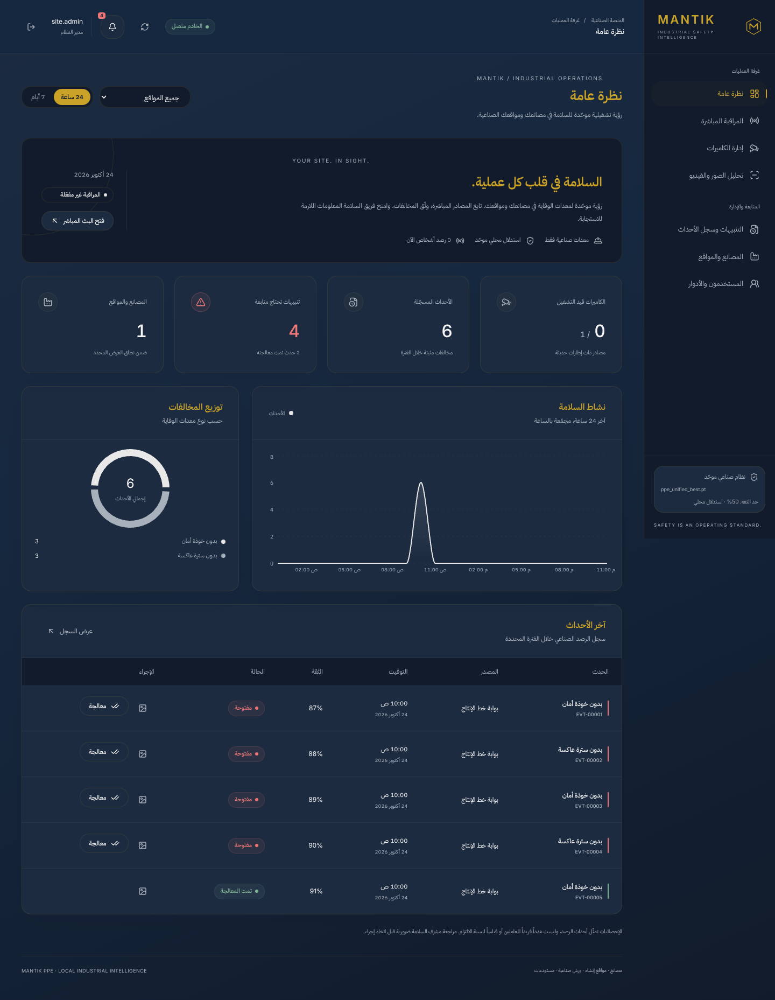

# Mantik PPE — توحيد القرار والهوية والتحقق

تاريخ التنفيذ: **24 أكتوبر 2026**. خط الأساس: `55a8888905dc0bde6505f2e8af95c53e6e11044f` على main. هذا التحديث لاحق لتقرير المصادر والثيم السابق؛ لا يعيد نسب نتائج الإصدار السابق إلى هذا العمل.

## 1. ما تغيّر فعليًا

- الهوية المعروضة **Mantik / Mantik PPE**: الدخول، شعار M واسم Sidebar، العناوين، browser title/favicon، footer، API، إيميل/Slack واسم CSV، أدلة التشغيل وأدوات CLI. لا توجد علامة تسجيل تجاري غير موثقة.
- طبقة قرار مشتركة قبل الرسم والعدادات والتنبيه، مع حد مستقل للدليل السالب وقدرات قواعد مشتقة من الوزن الفعلي.
- الحفاظ على Navy + Gold المركزي، مع تخفيف الزخرفة والظلال والألوان البيانية وزيادة تنفّس البطاقات؛ لا تغيير إلى وضع فاتح أو خلفية بيضاء.
- حفظ مصادر الكاميرات الستة الحقيقية وضوابط الشبكة وكلمات المرور؛ لا استبدال قارئ فيديو حقيقي بعنصر واجهة أو محاكاة إنتاجية.
- لا مسار منتج خارج السلامة الصناعية، ولا وزن بديل أو تنزيل تلقائي أو محمّل ثانٍ.

**كل ملف وسبب تغييره، بما فيه الصور والاختبارات:** [MANTIK_CHANGE_MANIFEST.md](MANTIK_CHANGE_MANIFEST.md).

## 2. حسم تناقض PPE

المصدر الواحد للسياسة `app/core/postprocess.py`؛ تستعمله `PPEDetector` و`CameraManager` ومسار الصور و`ViolationChecker` و`annotate_frame`. إعادة تطبيقه آمنة وثابتة ولا تعدّل مخرجات النموذج الخام.

1. تطبيع المفردات، استبعاد الفئات غير الصناعية والأدلة غير الصادرة عن النموذج والقيم/المستطيلات غير الصالحة وما دون حد العرض.
2. ربط كل قطعة بـPerson بأكبر IoU؛ التعادل/غياب التداخل بأقرب مركز. `person_index` رقم **محلي للإطار** وليس tracking ID.
3. تجميع الأدلة للشخص والقاعدة نفسيهما؛ التداخل هو IoU ≥0.10 أو تقاطع ≥50% من مساحة الصندوق الأصغر. هذا يشمل صندوق خوذة صغيرًا داخل صندوق سالب كبيرًا.
4. داخل كل مجموعة متصلة متعارضة يُختار أقوى موجب وأقوى سالب، ثم **فائز واحد فقط**:
   - التعادل أو فرق أقل من `0.08` → الموجب.
   - منطقة عدم اليقين `0.08` إلى أقل من `0.15` لصالح السالب → الموجب تحفظًا.
   - لا يفوز السالب إلا بتفوق ثقة **`0.15` على الأقل**؛ حدود المقارنة العشرية مغطاة بالاختبارات.
5. لا يحذف موجب شخص دليل شخص آخر. الأجزاء غير المتداخلة مستقلة، ومنها قفازان بمناطق مختلفة. إذا غاب Person لا يُختلق؛ يُحسم التداخل مكانيًا فقط.
6. النتيجة المحسومة تسبق JSON والمعاينة وعدادات WebSocket ودليل الحدث والثبات؛ لا يولد السالب الأضعف المتعارض إنذارًا من مسار جانبي.

### الانحدار المطلوب

```text
Person 0.95 + Hardhat 0.68 + NO-Hardhat 0.60 (المنطقة نفسها)
  => Person + Hardhat فقط
  => لا NO-Hardhat في JSON أو الرسم أو العدّ
  => لا حدث مخالفة، حتى بعد نافذة الثبات/التبريد
```

اختبار معاكس يبقي السالب المتفوق بوضوح ويسمح بإنذار حقيقي فقط بعد الثبات؛ الإصلاح ليس تعطيلًا عامًا للإنذارات أو إخفاءً للسالب.

## 3. الثقة والثبات وقدرات الوزن

```dotenv
DETECTION_CONFIDENCE=0.50
DETECTION_NEGATIVE_CONFIDENCE=0.60
VIOLATION_PERSIST_SECONDS=8
VIOLATION_PERSIST_FLOOR_SECONDS=8
ALERT_COOLDOWN_SECONDS=60
```

- حد السالب قابل للضبط من `0.55` فأعلى؛ الافتراضي `0.60`. حد الإنذار الفعلي `max(display, negative)`، فلا يؤدي خفض أحد الإعدادين إلى تجاوز الآخر. الثبات وانقطاع الدليل والتبريد السابق محفوظة.
- Metadata المحمية بالمصادقة تعرض `negative_confidence` المضبوطة و`effective_negative_confidence` الفعلية، `supported_negative_rules`، قدرات الموجب/السالب لكل قاعدة، وسياسة الفروق. غياب metadata لا يُعرض كاعتماد لقدرات الوزن.
- حد أدنى متوافق: Person وHardhat وNO-Hardhat وSafety Vest. غياب NO-Safety Vest يعطل **السالب للسترة فقط**؛ تبقى السترة الموجبة قابلة للاختيار والعرض. تعرض الواجهة «عرض فقط» بدل تعطيل checkbox المعدات كله.
- تبقى قواعد أخرى بدون سالب مدعوم بلا إنذار لها؛ لا يُختلق اسم فئة. `Boots` → `Safety Boots`، و`NO-Boots` → `NO-Boot`.
- Mask وLadder وSafety Cone وExcavator وأي أسماء خارج المفردات تُصفّى؛ ليست فئات منتج ولا سببًا منفردًا لفشل تحميل checkpoint متوافق. سياسة تجاهل هويات التكرار الموجودة على main محفوظة.
- المعاينة: معدات موجبة ذهبية، Person فاتح/رمادي، دليل سالب أحمر، وخلفيات labels كحلية مقروءة. اللون الأحمر **لا يساوي حدثًا زمنيًا مسجلًا**.
- صورة JPEG/PNG مرفوعة تُحلل مرة واحدة للمعاينة فقط، ولا تُرسل عبر فاحص الثبات أو تسجيل الأحداث، حتى مع سالب قوي. الفيديو والبث يبقيان على مسار الثبات.
- الثبات الحالي لكل كاميرا/قاعدة؛ لا يدّعي تتبع هوية العامل أو إحصاء عاملين فريدين أو احتساب نسبة التزام.

## 4. الهوية والثيم

`frontend/src/theme/mantik.css` يبقى المصدر الوحيد للألوان. القيم الأصلية مطابقة للطلب:

| العنصر | القيمة |
| --- | --- |
| Navy / deep / panel | `#16283F` / `#111B2B` / `#1C2B40` |
| Gold / soft / muted | `#C9A227` / `#D4AF37` / `#B8963E` |
| Text / soft / muted | `#F5F5F5` / `#E8E8E8` / `#A8B0BC` |
| الحد الذهبي العام | `rgba(201,162,39,0.12)` |
| نصف القطر | `1.1rem` |
| Hover / focus | `180ms` |

الرئيسيات والإجراء الأساسي والحالة النشطة ذهبية؛ الرسوم محايدة بدل تكرار بريق الذهبي، والفواصل خافتة. الأحمر للأخطاء/الأحداث والأخضر للنجاح فقط. شريط Sidebar النشط رفيع ومنطقي الاتجاه، مع مساحات أوسع وظلال طويلة أهدأ، بلا حركات زخرفية أو وضع فاتح. الستايل المركزي يطبق على الدخول واللوحة والرفع والكاميرات والأحداث والمواقع.

أسماء تقنية تاريخية بقيت للتوافق، **وليست اسم المنتج المعروض**: `useNexora`، cookies `nexora_access/nexora_media`، مجلدات `/var/nexora`، مفتاح `NEXORA_HOST` وصيغة النسخ المشفرة `NEXORA1`، واسم مستودع GitHub. لا نكسر جلسات أو أرشيفات أو تركيبًا قائمًا لمجرد إعادة التسمية. اسم الأرشيف الجديد Mantik مع الإبقاء على صيغة التشفير المتوافقة.

## 5. مصادر الكاميرات — محافظة موثقة لا ادعاء جديد

| النوع الصريح | السلوك المحفوظ والمتحقق برمجيًا |
| --- | --- |
| `rtsp` | الافتراضي والموصى به للإنتاج؛ مهلة فتح/قراءة وقيود prefix/شبكة |
| `rtsps` | بروتوكول مطابق منفصل، عبر قارئ RTSP؛ توافق TLS/الجهاز يُختبر بالموقع |
| `http_mjpeg` | قارئ multipart فعلي، Basic/Digest، حدود حجم/دقة ومهل ومحاولات وتنظيف |
| `hls` | تنزيل مقيد وقارئ PyAV معزول؛ TS/fMP4 وحي/VOD وAES-128 identity؛ لا DRM/LL-HLS أو renditions منفصلة |
| `file` | ملف مسموح/فيديو مرفوع، مرة واحدة بالمعدل الأصلي، انتهاء وتنظيف بلا replay تلقائي |
| `usb` | فهرس محلي فقط وتفعيل صريح في dev؛ ممنوع في staging/prod؛ ليس كاميرا متصفح المستخدم |

اختيار النوع أول الحقول، ثم تعليمات عربية وحقول URI/منفذ/مصادقة/فهرس مناسبة له. لا عرض لكلمة المرور المحفوظة، ولا مصدر arbitrary URL أو redirect/proxy مخفي. DNS/HTTP مقيدان بقوائم السماح وبحدود وقت/حجم. فشل مصدر يبقى برسالة آمنة ولا يسقط بقية الواجهة؛ انقطاعه يمسح البيانات والثبات القديم.

ONVIF **metadata/تسجيل RTSP المستخرج بأداة موثوقة فقط**؛ لا WS-Discovery ولا جلب URI تلقائيًا. لا ادعاء بأن كل كاميرا رخيصة أو سحابية لها مصدر قابل للقراءة. التفاصيل التشغيلية وحدود المصادر في [الدليل الصناعي](INDUSTRIAL_GUIDE_AR.md).

## 6. نتائج التحقق

| الفحص النهائي | النتيجة الفعلية |
| --- | --- |
| Backend — مجموعة كاملة | **485 PASS**، تحذير deprecation واحد من Starlette/httpx، دون skip أو إخفاق |
| Coverage — `app` | **81.55%**، أعلى من البوابة المحفوظة 75% |
| Postprocess / violation checker / annotation / capability metadata | **100% line coverage** لكل منها، وليس قياس دقة ML |
| Ruff check + format | نجاح؛ **120 ملفًا** منسقًا |
| Python compileall — app/migrations/scripts | نجاح |
| Frontend unit — Vitest | **9 PASS** |
| Desktop + mobile — Playwright | **50 PASS**، 0 flaky / 0 skipped / 0 unexpected؛ يشمل axe للصفحات والنماذج وRTL والمصادر الستة |
| TypeScript + Vite production build | نجاح |
| Oxlint / Prettier | 0 أخطاء أو تحذيرات ونجاح التنسيق |
| `npm audit --audit-level=high` | **0 vulnerabilities** |
| `bash -n scripts/backup_postgres.sh` / `git diff --check` | نجاح |
| سجل الملفات مقابل فرق Git | **60 مسارًا: 12 إضافة، 48 تعديلًا، 0 حذف** |

أُضيفت **68 حالة backend** إلى خط أساس 417، وست حالات متصفح (ثلاثة سيناريوهات على جهازين) إلى خط أساس 44. لم تُحذف اختبارات أو تُخفض بوابات الجودة. أمر فحص الوزن أدناه **إخفاق متوقع بسبب غياب artifact**، وليس من نتائج PASS أعلاه.

```bash
.venv/bin/ruff check app migrations scripts tests
.venv/bin/ruff format --check app migrations scripts tests
.venv/bin/python -m compileall -q app migrations scripts
.venv/bin/pytest -q --cov=app --cov-fail-under=75 --cov-report=term-missing
bash -n scripts/backup_postgres.sh
cd frontend
npm run format:check && npm run lint && npm test && npm run build
USE_PACKAGED_CHROMIUM=1 npm run test:e2e
npm audit --audit-level=high
```

استُخدم Chromium المعبأ في npm للبيئة محدودة الشبكة؛ يعمل CI العادي بمتصفح Playwright القياسي. نتائج CI والدمج مرتبطة بالـPR نفسه، ولا تُخلط بنتائج التحقق المحلي أعلاه.

### نطاق الاختبارات الجديدة

- جميع القواعد الخمس، التعادل وحدود 0.08/0.15، أكثر من شخص، الاحتواء/التداخل، أقرب مركز، عدم التداخل، عدم اختلاق Person، ترتيب المخرجات وإعادة تطبيق الحسم دون تعديل الخام.
- الحالة المطلوبة `.68/.60` عبر resolver والكاشف والرسم وفاحص الإنذارات؛ حد السالب المنفصل وإعادة الثبات عند اختفاء الدليل.
- HTTP image API: JSON والمعاينة بفائز واحد و**صفر أحداث** لكل من موجب فائز وسالب فائز؛ metadata للقدرات والحدود الفعلية، والسترة الموجبة عند غياب سالبتها.
- فك فيديو AVI فعلي ومرة واحدة عبر مدير المصادر: عدادات متسقة مع الحسم؛ الإنذار القوي بعد الثبات فقط. **الكاشف والساعة اختباران اصطناعيان صريحان**؛ ليس اختبار دقة ML.
- هوية Mantik وتوافق cookies/backup، وتسلسل Email/Slack بمخدمات إرسال mock دون اتصال خارجي.
- متصفح سطح مكتب وموبايل: الهوية بكل الصفحات، الصورة المحسومة دون سالب/حدث، وقاعدة السترة «عرض فقط» مع بقاء الاختيار والنتيجة الموجبة، مع مصفوفة المصادر الستة وفحص axe/RTL السابقين.

## 7. صور المراجعة

هذه صور **واجهة حقيقية تحت Playwright ببيانات عقود اختبار معلنة**؛ ليست بيانات منشأة أو دليل inference من الوزن المعتمد، ولا تدخل تلك البيانات حزمة الإنتاج.

- [الدخول — سطح مكتب](review/mantik/login-desktop.png) · [موبايل](review/mantik/login-mobile.png)
- [اللوحة — سطح مكتب](review/mantik/dashboard-desktop.png) · [موبايل](review/mantik/dashboard-mobile.png)
- [اختيار المصدر — سطح مكتب](review/mantik/camera-source-desktop.png) · [موبايل](review/mantik/camera-source-mobile.png)



## 8. حدود الاعتماد والترقية

- `Model/ppe.pt` غير موجود في هذا المستودع/البيئة. فحص `python -m app.model_check --smoke` يرجع **exit 1 متوقعًا** برسالة «Required industrial weights are missing». لا ينزل شيئًا ولا يبدأ inference بديلًا، ولا يُعرض هذا كنجاح اختبار للنموذج.
- لم تُقَس دقة ML أو FPS/GPU أو كاميرات RTSP/RTSPS/USB مادية. HTTP/HLS والفيديو يختبرون fixtures محلية حقيقية؛ ليست موافقة شبكة موقع. فحوص SQL/الترحيل محلية SQLite؛ لا شهادة نشر PostgreSQL/SQL Server/Docker ميدانية.
- الاختبارات البرمجية تثبت منع التناقض المحدد واتساق المسارات، **لا تعالج تلقائيًا أخطاء التنبؤ غير المتعارض أو اعتماد سلامة ميدانيًا**. يلزم ملف معتمد وبصمة وتقييم صور/ليل/ازدحام/حجب وكاميرات الموقع قبل اعتماد Pilot تشغيلي.
- لا ترحيل DB جديد لهذا التحديث: الربط محلي للإطار والقدرات مشتقة من نفس الوزن. تبقى ترحيلات `20261024ind` و`20261024src` السابقة كما هي. احتفظ بالنسخ والأدلة والإعدادات واتبع دليل الترقية السابق، ولا تستخدم `alembic downgrade` لاسترجاع بيانات محذوفة تاريخيًا.
- استمر في تشغيل مدير الالتقاط بعامل API واحد. لا تغير هذه المعالجة نموذج التزامن أو تمنح تنسيقًا موزعًا.
