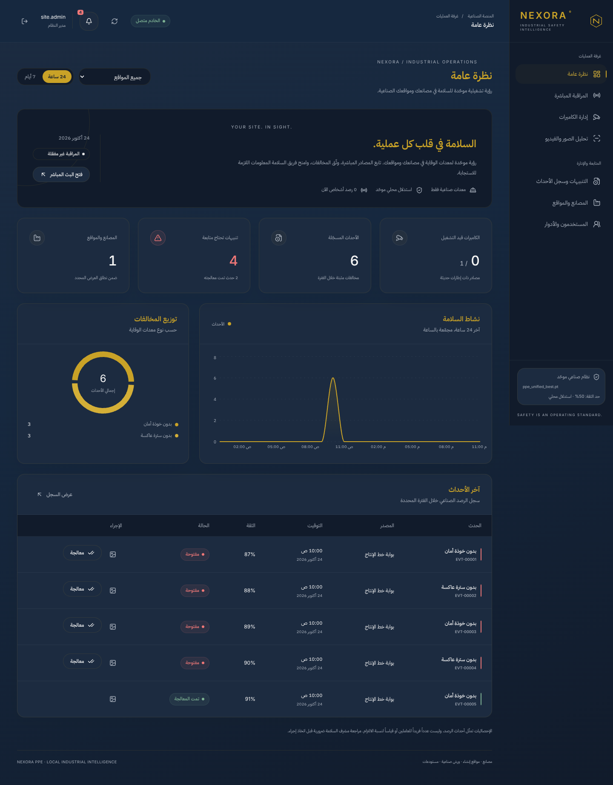

# تحديث MANTIK الهادئ ومصادر الكاميرات الستة

**التاريخ:** 2026-10-24 · **الفرع:** `arena/161684fc-nexora-ppe`
**مرجع اختبارات التطوير أدناه:** `37bf7a29547ba3fdcb466d9888387164d87e491e`. **أساس PR بعد المزامنة:** `dba1570bf9a9d54533e3cab71d7b34460d6aec36`، مع الحفاظ على تحديث توافق النموذج الذي أُضيف إلى main. هذا تقرير تنفيذ التحديث؛ تُراجع حالة Pull Request وفحوص CI والدمج النهائي في GitHub.

## 1. ما نُفّذ

### الواجهة

- ألوان MANTIK الأساسية التسعة دون استبدال، ومصدرها الوحيد `frontend/src/theme/mantik.css`.
- حدود البطاقات `rgba(201,162,39,0.12)` بدل 0.25، وزوايا `1.1rem` للبطاقات والحقول والأزرار الرئيسية، وظلال أطول أخف ومسافات داخلية أوسع.
- خلفية كحلية متدرجة بخفة، وشريط جانبي أعمق مع خط نشط رفيع منطقي الاتجاه، ونصوص وأيقونات ثانوية محايدة.
- أزرار رئيسية ذهبية ممتلئة بنص كحلي، وانتقالات hover/focus مدتها180ms؛ إزالة حركات دخول الصفحات/الحوار والنبض والدوران الزخرفي. مؤشر التركيز المرئي باقٍ للإتاحة.
- توحيد Login واللوحة والكاميرات والمواقع والأحداث والنماذج والحوارات؛ احتفاظ RTL، وإزالة استعمال الأخضر كلون لفئة بيانية لا تعني النجاح.
- تصحيح امتداد خلفية الصفحة الطويلة بعد مراجعة اللقطات، ثم إعادة مجموعة المتصفح كاملة بنجاح.

### المصادر وإدارة الاتصال

| النوع | التنفيذ الفعلي | الحدود المهمة |
| --- | --- | --- |
| `rtsp` | مسار OpenCV/FFmpeg السابق محفوظ، ومهل الفتح/القراءة واختبارات الإلغاء محفوظة | توصية الإنتاج؛ يلزم السماح بالشبكة وتحقق الجهاز الحقيقي |
| `rtsps` | نوع مستقل بنفس المحول، مع مطابقة البروتوكول وترقية صفوف RTSPS القديمة | توافق الجهاز وTLS في بناء OpenCV يحتاج اختبار الموقع |
| `http_mjpeg` | جلب HTTP(S) محدود، Basic/Digest، تجميع JPEG وفحص الدقة قبل فك OpenCV | multipart MJPEG فقط؛ لا HTML أو صورة ثابتة، 8MB للإطار وحد دقة افتراضي24MP |
| `hls` | جلب محكوم لكل الموارد، مخزن محلي خاص وقوائم ذرية، وفك PyAV/FFmpeg بعملية مستقلة لا تتصل بالشبكة | TS188/fMP4، حي/VOD، AES-128 identity؛ حدود الموارد موثقة، لا DRM/LL-HLS/renditions منفصلة |
| `file` | مسار MP4/AVI داخل مجلد الخادم المسموح، مع الالتقاط السابق | مرة واحدة بمعدل الملف الأصلي؛ لا إعادة تلقائية |
| `usb` | محول OpenCV داخل عملية منفصلة يمكن إنهاؤها عند تعليق السائق | dev محلي فقط مع تفعيل وفهرس مسموح؛ غير متاح في staging/prod، ولم يُختبر جهاز فعلي |

اختيار النوع هو أول حقل، ثم تظهر حقول URI/المنفذ/المسار/فهرس الجهاز والمصادقة المناسبة مع إرشاد عربي. `source_type` وبديله `type` مدعومان في API، مع رفض الأنواع والبروتوكولات والحقول غير المتوافقة.

بيانات الدخول للكتابة فقط، وحقل كلمة المرور مقنّع وفارغ عند إعادة فتح التحرير. لا تُرجع استجابات API اسم المستخدم أو كلمة المرور أو الرابط الخاص الكامل. الرابط البديل لا يرث كلمة مرور الرابط السابق، ويمكن استبدال/مسح المصادقة صراحةً. **بيانات الاتصال الخاصة ما زالت محفوظة داخل قاعدة التثبيت الحالية؛ هذا ليس تنفيذًا لتشفير حقولها على القرص.**

الحالات الظاهرة: starting/running/retrying/stopped/completed/error، مع خطأ آمن محفوظ. المحاولات محدودة، وتُمسح الإطارات والعدادات والثبات وبوابة أول إطار عند الانقطاع، وتُرسل حالة الانقطاع إلى WebSocket دون اصطناع أعداد. VOD/الملفات لا تعاد تلقائيًا؛ توقيت HLS يحافظ على PTS بدل معالجة VOD كدفعة سريعة تتجاوز زمن ثبات PPE.

**ONVIF بيانات تعريف فقط:** حفظ عنوان جهاز محكوم، مع إرشاد لاستخراج RTSP بأداة الجهاز/أداة موثوقة. لا discovery أو استخراج URI أو قراءة فيديو ONVIF، ولا ادعاء بعكس ذلك.

## 2. حدود الشبكة والموارد

- RTSP وقائمة HTTP مستقلتان؛ HTTP مغلق افتراضيًا. كل URI ومورد HLS، بما فيه المفتاح وخريطة التهيئة، يُفحص قبل الوصول إليه.
- DNS يُفحص ثم يُثبت IP للاتصال، مع Host/SNI الأصليين والتحقق الافتراضي من TLS. لا بروكسي بيئة ولا اتباع تحويلات، ولا إرسال مصادقة إلى أصل آخر.
- منع loopback افتراضيًا وmetadata/link-local/الوجهات المحظورة، ومسارات التفاف/ترميز ملتبسة. استثناء loopback يحتاج dev ومفتاحًا صريحًا وقائمة سماح مطابقة، ولا يُسمح به في staging/prod.
- موارد HLS تُفحص كـTS أو BMFF حتى بعد فك AES-128، لمنع قوائم متنكرة أو مراجع ملفات خارجية. مفكك الطفل لا يحصل على URL/مصادقة الشبكة، وبروتوكولاته `file,crypto` فقط. هذا دفاع تطبيقي وليس بديلًا عن جدار ناري/VLAN وتحديث المكتبات الأصلية.
- افتراضيًا: 3 إخفاقات قراءة، ومحاولتا إعادة فتح إجمالًا لكل تشغيل، وفاصل1s. HTTP10s فتح/10s قراءة؛ فتح HLS محدود بمجموعهما. USB5s فتح/3s قراءة.
- HLS: قائمة256KB/1024 سطر/64 مقطع، مورد32MB، مخزن128MB قابل للضبط16–512MB، وخرج960×540 مع حفظ النسبة وحتى5fps افتراضيًا. هذه حدود نقل/فك وليست قياس سرعة أو جودة الاستدلال.
- مولّد الإنتاج يدعم `--http-prefix` أيضًا وتثبيت HTTP-only بلا قائمة RTSP صورية؛ RTSP يظل الافتراضي الموصى به. Compose الإنتاجي يعطّل USB/loopback صراحةً.

الاعتماد التشغيلي للمفكك هو **PyAV18.1.0** بحزم FFmpeg المرفقة في بيئة الاختبار. لم يُعتمد executable القديم المرفق بـimageio-ffmpeg لفك الإنتاج بعد ظهور انهيار في فك TS في هذه البيئة؛ بقيت imageio-ffmpeg في **متطلبات الاختبار فقط** لتوليد العينات. اختبارات الفك الفعلي اللاحقة تستخدم مسار PyAV التشغيلي نفسه، لا محاكاة للفك.

## 3. الترحيل

ترحيل جديد إضافي `20261024src` بعد `20261024ind`، يضيف:

- `device_index`
- `auth_mode`، افتراضيًا basic
- `onvif_device_uri`
- `last_error`

ويصحح `source_type` للصفوف القديمة ذات URI من نوع RTSPS. لا يحذف مصادر أو مواقع أو قواعد أو أحداث، ولا يعيد تنظيف الإصدار السابق. اختبار SQLite يثبت الحفاظ على الصفوف والأحداث والعلاقات وتكرار upgrade دون حذف. النسخ الاحتياطي والاستعادة المتوافقة مع إصدار التطبيق يظلان شرطًا؛ لم يُختبر هذا الترحيل على PostgreSQL/SQL Server حقيقيين في هذه البيئة.

## 4. التحقق المنفذ

نتائج التطوير التالية سُجلت قبل مزامنة تحديث main المتزامن. فحوص PR تعيد تنفيذ المجموعة الكاملة بعد المزامنة. أُصلح تنسيق `ppe.py` الذي تسبب في فشل CI على main، وحُدّثت اختبارات عقد الفئات لتتحقق من سياسة main الحالية: الحد الأدنى الحالي والفئات الصناعية المفلترة، وعدم تسريب IDs المتجاهلة أو اختلاق فئة سالبة غائبة. لم يُعدّل منطق `detector.py` من جانب هذا الفرع.

| البوابة | النتيجة |
| --- | --- |
| Backend كامل مع بوابة التغطية75% | **412 passed**، failures0/errors0/skipped0؛ تغطية **80.42%** |
| تحذيرات Backend | تحذير upstream واحد: Starlette TestClient/httpx deprecation |
| فيديو HLS فعلي عبر HTTP محلي محكوم | TS وfMP4 وAES-128؛ إطارات مفكوكة فعلية، PTS pacing، VOD EOF، تحديث حي وإيقاف مع backpressure وحذف الملفات المؤقتة |
| MJPEG فعلي عبر HTTP | JPEG متعدد الإطارات، Basic وDigest مع تحدٍ محسوب، ورفض HTML/التحويلات |
| سياسة المصادر وAPI | الأنواع الستة، المنافذ والحقول المتعارضة، الأسرار/التدقيق، DNS pinning، رفض وجهات/موارد غير مسموحة، المهل وحدود الجسم، حالات الخطأ وONVIF metadata |
| USB | اختبار عملية سائق **اصطناعي صريح** معلقة وإنهائها بمهلة، وحظر السياسة خارج dev؛ **ليس اختبار جهاز** |
| RTSP وملف الفيديو | اختبارات المحول السابقة باقية، بما فيها مهل FFmpeg والإلغاء/التحرير والملف الأصلي مرة واحدة |
| Ruff وفحص تنسيق Python | ناجح؛116 ملف Python مفحوصًا |
| Frontend unit | **9 passed** |
| Frontend lint/format/build | ناجحة |
| Playwright | **44 passed**:22 سيناريو × سطح مكتب/هاتف، بلا retries/flaky أو تخطٍّ؛ إعادة كاملة بعد تصحيح الخلفية الطويلة |
| الإتاحة وRTL | axe ناجح للصفحات والحوارات، بما فيها نموذج الأنواع الديناميكي؛ لا تجاوز أفقي في الاختبارات |
| npm audit | **0 vulnerabilities** |
| git diff --check | ناجح |
| بوابة النموذج المعتمد | **فشل متوقع exit1** لأن `Model/ppe.pt` غائب؛ لم ينزل/يستبدل أي وزن |

ملفا التقارير الآلية المحليان في مجلدات الاختبار المتجاهلة: `test-results/backend.xml` و`frontend/test-results/browser-results.json`. تم التحقق من عدادات نجاحهما وعدم وجود إخفاقات. قياس تغطية العملية الرئيسية لا يجمع سطور طفل HLS تلقائيًا؛ اختبارات الفيديو الأصلية أعلاه تؤكد سلوكه عبر الإطارات الفعلية، ولا يصح تفسيرها كتقييم دقة ML.

## 5. مراجعة الواجهة

هذه لقطات من المتصفح **بـAPI fixtures للاختبار فقط**. الأعداد والحسابات والأحداث الظاهرة ليست بيانات موقع حي أو نتائج النموذج. لم تُضف fixtures إلى كود الإنتاج.

- [لوحة سطح المكتب](review/mantik-dashboard-desktop.png) · [لوحة الهاتف](review/mantik-dashboard-mobile.png)
- [دخول سطح المكتب](review/mantik-login-desktop.png) · [دخول الهاتف](review/mantik-login-mobile.png)
- [نموذج المصادر — سطح المكتب](review/mantik-source-desktop.png) · [نموذج المصادر — الهاتف](review/mantik-source-mobile.png)

## 6. ما لم يُثبت ميدانيًا

- الوزن المعتمد غائب؛ لم يبدأ API/الاستدلال الحقيقي، ولم تُقاس دقة PPE أو GPU أو سرعة الكاشف.
- لا كاميرا RTSP/RTSPS/USB فعلية أو كاميرات تجارية مصرية موصولة. نجاح محولات الاختبار لا يثبت توافق جهاز بعينه أو TLS الخاص به.
- لا نشر Docker/Compose/قواعد بيانات موقع فعلية أو اختبار شبكة/شهادات/نسخ واستعادة أو تسليم تنبيهات خارجي.
- محدودية HLS/ONVIF/USB أعلاه مقصودة ومعلنة؛ الأجهزة ذات بروتوكول سحابي مغلق تحتاج مصدرًا قابلًا للقراءة أو وسيطًا متوافقًا، ولا يوجد دعم سحري لها.

منطق `app/core/detector.py` محفوظ كما هو في آخر main، ولا وزن بديل أو تغيير في مسار الاستدلال الواحد. التغيير في `ppe.py` تنسيق فقط؛ التوافق الأحدث مع أسماء النموذج جاء من تحديث main نفسه. راجع [الدليل الصناعي](INDUSTRIAL_GUIDE_AR.md) لإعداد المصادر وmediamtx/FFmpeg، و[قائمة كل الملفات وأسبابها](SOURCE_THEME_CHANGE_MANIFEST.md) لدلتا هذا الفرع.
